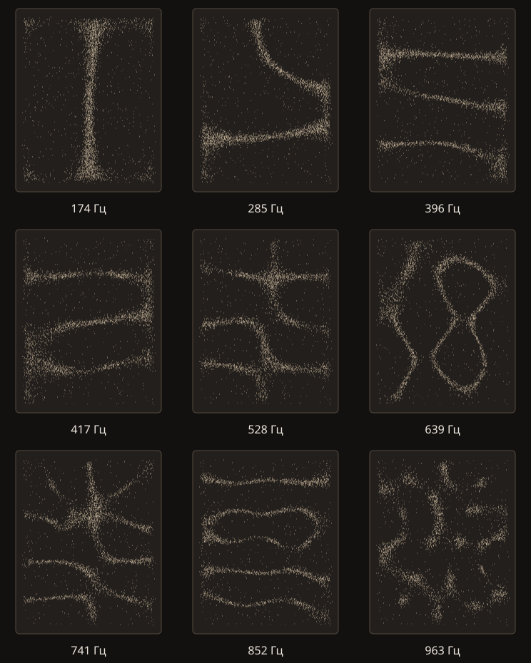

# Расчёт фигур Хладни



Все девять изображений рассчитаны для одной тонкой алюминиевой пластины 230 × 290 × 0,8 мм с шарнирным опиранием по четырём краям. Модуль Юнга равен 69 ГПа, плотность — 2700 кг/м³, коэффициент Пуассона — 0,33. Относительное затухание всех мод равно 0,008. Сила действует в точке на 0,31 ширины и 0,43 высоты от угла пластины.

Модель Кирхгофа — Лява использует синусоидальные моды `φₘₙ(x,y) = sin(mπx/a) sin(nπy/b)`. Их угловые частоты равны `ωₘₙ = √(D/(ρh)) · ((mπ/a)² + (nπ/b)²)`, где `D = Eh³/(12(1 − ν²))`. Для каждой заданной частоты генератор складывает комплексные отклики мод на гармоническую силу. Вклад каждой моды пропорционален её значению в точке возбуждения и обратно пропорционален `ωₘₙ² − ω² + 2iζωₘₙω`. Модальная масса всех мод одинакова и равна четверти массы пластины. Амплитуда в каждой точке — модуль суммы. [Работа о реконструкции фигур Хладни](https://doi.org/10.1121/1.4916704)

Скрипт рассчитывает 64 × 64 моды на сетке 240 × 303 точки. Песчинки чаще попадают в области малой амплитуды. Полоса шириной 4,5% по периметру исключена из выборки, а плотность рядом с этой полосой плавно уменьшается, чтобы песок не скапливался у опор. Для всех рисунков генератор использует одни и те же случайные квантили. В iOS отображаются те же 4096 точек на рисунок, что и на контактном листе.

Среднеквадратичный расчётный отклик варьируется от 7,63 до 240,61 мкм/Н. Относительное расхождение амплитуд с расчётом на 80 × 80 модах меньше 0,004% для каждой частоты. Наиболее похожая пара — 396 и 417 Гц, косинусная близость распределений плотности песка в ней составляет 0,481. На контактном листе различие видно по наклону средней линии и форме боковых ветвей.

Из корня репозитория контактный лист и таблицы координат для iOS воспроизводятся одной командой.

```sh
node scripts/generate-tone-grains.mjs
```
